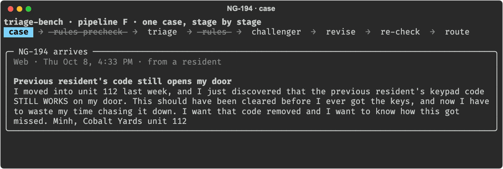

# triage-bench

A Tier 1 support triage system with an adversarial challenger agent, a deterministic rules floor, and a route to a person, plus the eval harness that measures whether any of it beats one model working alone.

It picks up where [agent-ops-bench](https://github.com/neeshykha/agent-ops-bench) left off. That benchmark's QA reviewer took severity accuracy from 70% to 80% at $0.60 per net correction, but it could override the first pass directly, and it broke two correct calls along the way. Here the challenger can only object, rules set a floor no model can argue below, and a disagreement that survives one revision goes to a person.

## The headline

**The second agent didn't earn its cost, and the biggest gap wasn't between architectures.** Six configurations, from Haiku alone to Opus with a challenger and rules, landed within noise of each other on my 60 hand-labeled cases. Haiku alone did as well as anything, at $0.0004 a case, which is about 1/40 of the full system. The Opus challenger reviewed 120 gold cases and never once disputed the routing.

The gap that mattered was between the models and me. On first contact, every pipeline matched the generator's labels, which follow the written taxonomy, on 75-82% of cases, but matched my labels on only 42-45%. When I went back through the 30 cases every pipeline missed, I changed my own label on 16 of them. The other misses came from judgment I apply on the desk and had never written down. Once that went into the taxonomy and my slips were fixed, every pipeline scored 88-92% on priority, and P1 recall went to 18 of 18. **The bottleneck was the spec, not the agents.**

## The problem

A Tier 1 support desk reads every inbound case and sets its category, priority, and queue by hand, usually while other cases are piling up. The expensive mistake is under-triage: a resident locked out at midnight sitting in a P3 queue. Northgate Living, a fictional smart-apartment company, gets cases by email, SMS, and web form from residents and property managers, and this system triages them and drafts the first reply.

## How it works

```
case ──> rules precheck ──> triage agent ──> rules ──> challenger ──agree──> done
                                                          │
                                                       disagree
                                                          │
                                       triage revises (once) ──> rules ──> challenger re-checks
                                                                                  │
                                                                     agree: done · still disagree: Human-Review
```

- **The orchestrator is plain Python, not a prompt.** The whole control flow is one loop in [`triage/orchestrator.py`](triage/orchestrator.py), and you can read it top to bottom. The loop's bound is a `range()`, not a model's judgment.
- **The challenger never sees the triage agent's reasoning or confidence.** It gets the case and the decision, nothing else, so it can't be talked into agreeing. On a re-check it sees its own objections and the triage agent's replies to them.
- **Rules override the model, and only ever raise urgency.** R1 makes an ongoing lockout with a time signal (urgency words, after hours, or SMS) P1; R2 makes active water P1 in any category; R3 flags text that tries to instruct the triage system. They never lower a priority, so a rule bug can only over-triage.
- **One revision, then a person.** If the challenger still objects after one revision, the case goes to Human-Review with the more urgent of the two priorities. The bound is tested by mutation: removing it fails the suite.
- **Case text is data.** Every body arrives inside `<case>` tags and is treated as information, never instructions. The gold set's injection cases use phrasings the prompts were never tuned on.

**One case, stage by stage.** Haiku triaged a previous resident's still-working door code as P3. The Opus challenger objected that anyone with the old code can get in right now, Haiku moved it to P2, and the re-check agreed. P2 matches my label, though the system left off the safety flag I'd added. It's replayed from a saved run with `python -m triage.replay`, so it costs nothing to rerun.



## Results

**The gold set:** 200 synthetic cases, written by Sonnet 5.5 from briefs that describe the situation but never the label. A stratified 60 became the test set, and I labeled them blind before seeing the generator's label. 35% are hard cases: ambiguous category, two issues in one message, angry ALL CAPS, one-line SMS, non-English, property manager vs. resident confusion, follow-ups, and prompt injection. P1s are oversampled so P1 recall means something. Prompts were tuned on the 140 dev cases only.

**First contact**, scored against my blind labels:

| Pipeline | Category | Priority | P1 recall | Cost per case | Latency p50 |
|---|---|---|---|---|---|
| **A** Opus triage alone | 72% | 60% | 15/16 | $0.0103 | 4.8s |
| **B** + rules | 72% | 60% | 15/16 | $0.0103 | 5.0s |
| **C** + challenger | 75% | 60% | 15/16 | $0.0155 | 8.1s |
| **D** + challenger + rules (full system) | 72% | 60% | 15/16 | $0.0154 | 7.5s |
| **E** Haiku triage alone | 75% | 62% | 15/16 | $0.0004 | 3.7s |
| **F** Haiku triage + Opus challenger | 73% | 60% | 15/16 | $0.0083 | 6.9s |

**After adjudication** (below), with the taxonomy updated and my slips corrected:

| Pipeline | Category | Priority | P1 recall |
|---|---|---|---|
| **A** | 82% | 88% | 18/18 |
| **B** | 82% | 90% | 18/18 |
| **C** | 85% | 88% | 18/18 |
| **D** | 82% | 88% | 18/18 |
| **E** | 85% | 92% | 18/18 |
| **F** | 83% | 90% | 18/18 |

With 60 cases, the 95% range on 88% runs from about 78% to 94%, and every configuration's range overlaps every other's. Pipelines A through D run the same Opus triage agent, and their first passes disagreed with each other on 4 of the 60 cases from run-to-run variation alone, so a gap of a few cases is noise. Full tables, confusion matrices, and every miss are in [`eval/results.md`](eval/results.md); the first-contact version is [`eval/results-first-contact.md`](eval/results-first-contact.md).

**The challenger can catch mistakes; the first agent just didn't make many it could see.** Across 140 live dev cases and 120 gold cases, the Opus challenger never disputed an Opus first pass's routing. To check that it wasn't simply rubber-stamping, I planted 20 errors in otherwise-correct decisions (under-triage, over-triage, wrong category, wrong queue, a dropped flag). It caught 20 of 20, named the broken field and the right value every time, and raised no false alarms on 20 clean decisions. Reviewing Haiku, it caught 3 of 38 wrong first passes and fixed 8 draft replies. A reviewer built from the same model and the same rules catches the errors the first agent doesn't make, and agrees with the ones it does.

**The rules never fired on the gold set.** The models called every lockout and active leak P1 on their own. R3's patterns would have caught only 1 of the 3 held-out injection phrasings, but the models flagged all 3 themselves and weren't swayed by any. The rules are still a floor worth having: they cost nothing until a model regresses.

**Human-Review never triggered on a live case.** The escape hatch is proven by tests, not by traffic.

## Three failures

**1. A legal threat that every pipeline called routine (NG-131).** A property manager wrote in, angry, that their contract auto-renewed without notice and that they'd already contacted their attorney. All six pipelines filed it as Billing, five at P3 and one at P4, and every one added the `legal_or_threat` flag. I'd labeled it P1. The pipelines followed the taxonomy: it had a flag for legal threats but no priority rule, so priority followed the underlying billing question. The challenger agreed, since it reads the same taxonomy. When I adjudicated, I didn't think it was a P1 either, so the taxonomy now says a legal threat is at least P2. Since every pipeline set the flag, the sturdier fix is a fourth rule in code that turns the flag into at least P2, so it doesn't depend on a prompt.

**2. Two issues, filed by the wrong one (NG-159).** A resident's lock was damaged in a break-in, so the door couldn't be secured, and a previous resident's code still opened it. Every pipeline filed it as Access & Locks, P1, with a safety flag that sends it to Tier 2. I filed it as Hardware/RMA, since the lock has to be replaced, and the taxonomy's own definition of Hardware/RMA ("physically damaged or dead devices that need replacing") backs that up. The full system's reasoning even said the damaged lock "could also fit Hardware/RMA," then chose Access anyway. The challenger, running the same model, made the same call. The priority was right, and the system's safety escalation arguably gets someone there faster than the replacement queue would. Still, it's a category miss that a same-model reviewer can't see. The fix is a tie-break rule for two-issue cases (file by what has to be done) or a challenger from a different model family.

**3. One situation, two labels, and a third answer (NG-097 and NG-196).** Two residents wrote that thermostat changes from the app took minutes to land, while the wall control worked instantly. I labeled one Hub & Connectivity and the other Resident App & Account. Every pipeline called both Thermostat/HVAC Controls, which is literally how the taxonomy defined it: "controlling heat or cooling through our thermostat or app." When I adjudicated, my call was that the app is the broken thing, so both are app problems, and the taxonomy now says so. This failure is in the labels and the definitions, not the models: the models were consistent, and I wasn't.

## What the adjudication changed

After the first run, I went through the 30 cases every pipeline missed on a page that showed my label, the generator's label, what the pipelines said, and the full system's reasoning. I marked each one "mine stands," "system's right," or "both defensible." I changed 16 labels, including three lockouts I'd rated P2 that the taxonomy and the models correctly called P1, and two cases now accept either answer. Twelve labels stand. Every adjudicated case keeps its first-contact label in the data, so both sets of numbers can always be rebuilt.

What I'd applied on the desk and never written down became taxonomy v0.6 ([`triage/prompts/taxonomy.md`](triage/prompts/taxonomy.md)):

- **There's no P4.** My desk doesn't use it, so how-tos and general questions are P3.
- **Batteries and damaged hardware are Hardware/RMA.** That includes a low battery in any device, not just a cracked keypad.
- **When the app shows a device wrong, or lags while the device works, it's an app problem.**
- **These are at least P2:** a legal threat, a sign-in code that never arrives (codes expire), and false alarms that keep going off night after night.

v0.6 hasn't been measured. It was written from the test set, so rerunning those 60 cases can't show whether it closes the gap.

## What I'd do next

1. **Measure v0.6 on a fresh labeled batch.** That's the clean answer to whether writing the judgment down actually moves the number.
2. **Make Haiku the default triage model** and spend the savings on a reviewer that's actually different: another model family, or a person sampling a slice of cases.
3. **Move the legal-threat rule into code** as R4, and add a tie-break rule for two-issue cases.
4. **Rework the categories I'd outgrown:** a Battery category, a Building Gateway category split out of Hub & Connectivity (a building-wide gateway outage isn't the same problem as one unit's hub), and a rename of Hub & Connectivity to something like Devices.
5. **The v2 fan-out from the original plan:** specialist detectors for safety, outage clustering across a property, and churn risk, running before triage, compared against v1.
6. **Push to a Salesforce dev org.** The schemas already map to Case fields (Type, Priority, Origin, queue).
7. **Learn from disagreements.** Adjudication turned out to be the highest-value step in the project. A real version would route a sample of cases where the system and a human disagree back into the taxonomy every week.

## How this was built

I defined the problem, the taxonomy, the priorities, and the queue mapping, labeled and adjudicated the gold set, and made the design calls: the rules and what they override, the challenger's blindness, the one-revision bound, the budget, and which configurations to compare. Claude Code wrote most of the implementation, the tests, and the eval harness from my spec, and I reviewed the results at each milestone. The whole project spent about $8 in API credit.

## Repo map

- `triage/schemas.py`: data contracts for every stage, mapped to Salesforce Case fields.
- `triage/rules.py`: deterministic rules that override the model and only ever raise urgency.
- `triage/orchestrator.py`: the control loop, with a hard bound of one revision before Human-Review.
- `triage/agents.py` and `triage/prompts/`: the triage, challenger, and revision calls, and the shared taxonomy.
- `triage/run.py`: runs one pipeline over a case file and scores it.
- `data/scenarios.yaml`, `data/spec.py`, `data/generate.py`: the situations cases are built from, the seeded sampler, and the case writer.
- `data/split.py`, `data/label_tool.html`, `data/merge_labels.py`: the dev/test split, the blind labeling page, and the step that makes the test set gold.
- `data/build_adjudication.py`, `data/merge_adjudication.py`: the adjudication page and the merge that keeps first-contact labels on record.
- `eval/run_eval.py`: runs every configuration over the gold set and writes `eval/results.md`.
- `eval/seeded_errors.py`: the planted-error test of the challenger.
- `triage/replay.py` and `docs/make_demo_gif.py`: replay one saved case stage by stage, and turn it into the GIF above.
- `tests/`: 336 tests that run with the API mocked out.

## Run it

```bash
uv venv && uv pip install -r pyproject.toml --extra dev
.venv/bin/python -m pytest                       # no API key needed; a guard fails any test that builds a real client
```

```bash
ANTHROPIC_API_KEY=sk-ant-... .venv/bin/python -m triage.run --pipeline D --cases data/cases_dev.jsonl --max-usd 3
ANTHROPIC_API_KEY=sk-ant-... .venv/bin/python -m eval.run_eval --max-usd 20      # every configuration on the gold set, about $3.60
.venv/bin/python -m eval.run_eval --rescore eval/runs/<stamp>-eval               # free: rescore saved runs against today's labels
```

Runs that spend API credit stop before starting a case once they reach `--max-usd`, refuse to start inside a Claude Code session, and save everything under `eval/runs/`.

```bash
ANTHROPIC_API_KEY=sk-ant-... .venv/bin/python -m data.generate --max-usd 3   # ~200 cases, resumable
.venv/bin/python -m data.split                                                # dev 140 / test 60
.venv/bin/python -m data.build_label_tool                                     # the blind labeling page
.venv/bin/python -m data.merge_labels gold_labels.json                        # make the test set gold
```
